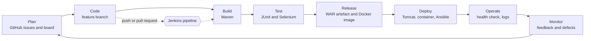

# Task 2 - Agile planning and DevOps workflow

## User stories and acceptance criteria
| ID | Story | Acceptance criteria |
|----|-------|---------------------|
| US-1 | As a user I want to sign in so that only staff can use the portal | Valid login opens the dashboard; wrong password shows an error; pages redirect to login when signed out |
| US-2 | As an operator I want to create a certificate record so that I can start the approval process | Form validates name, email, course, date; new record is saved as Draft with a number like CERT-2026-1001 |
| US-3 | As a user I want to view a record so that I can see all details and its status | View page shows all fields, status badge and who last updated it |
| US-4 | As an operator I want to update a draft or rejected record so that I can correct mistakes | Edit allowed only in Draft or Rejected; submitted/approved/issued records are read-only |
| US-5 | As a user I want to search and filter records so that I can find them quickly | Search by name, number or course (case-insensitive, partial) and filter by status; empty result shows a message |
| US-6 | As an approver I want to approve or reject submitted records so that only correct data is issued | Approve/Reject buttons appear only for approvers/admins and only for Submitted records |
| US-7 | As an administrator I want to issue approved records so that the certificate becomes final | Issue button only for admins and only for Approved records |
| US-8 | As a manager I want a dashboard so that I can see progress at a glance | Shows total and count per status; counts add up to the total |
| US-9 | As the DevOps team I want a health endpoint so that deployments can be verified automatically | `/health` returns HTTP 200 and JSON with status UP when the database answers |
| US-10 | As the DevOps team I want every commit built and tested automatically so that defects are caught early | Jenkins builds on commit, publishes test reports, blocks deployment on failure |
| US-11 | As the DevOps team I want the application packaged as a container so that it runs the same everywhere | Versioned image builds, starts and passes the health check |
| US-12 | As the DevOps team I want the server configured by script so that environments are reproducible and recoverable | Ansible playbook is idempotent; rollback restores the previous release |

## Product backlog (15-task MVP)
| Task | Title | Story | Estimate (h) | Sprint |
|------|-------|-------|--------------|--------|
| T01 | Repository, Maven skeleton, README, branch policy | - | 2 | 1 |
| T02 | Database schema, demo users and sample data | US-1, US-2 | 2 | 1 |
| T03 | Login, session, CSRF token, role model | US-1 | 3 | 1 |
| T04 | Create certificate with validation | US-2 | 3 | 1 |
| T05 | View and list certificates | US-3 | 2 | 1 |
| T06 | Dashboard with status counts | US-8 | 2 | 1 |
| T07 | Update (edit) certificate | US-4 | 2 | 2 |
| T08 | Search and status filter | US-5 | 2 | 2 |
| T09 | Role-based status workflow | US-6, US-7 | 4 | 2 |
| T10 | Health endpoint and environment configuration | US-9 | 1 | 2 |
| T11 | Unit tests (JUnit) | all | 3 | 2 |
| T12 | Selenium tests (5 journeys) | all | 4 | 3 |
| T13 | Jenkins pipeline: build, test, package, deploy | US-10 | 4 | 3 |
| T14 | Docker image and Jenkins-Docker delivery | US-11 | 3 | 3 |
| T15 | Ansible provisioning, idempotency, rollback | US-12 | 4 | 3 |

`scripts/create-issues.sh` creates one GitHub issue per task and story (needs the GitHub CLI `gh`).

## Sprint plan (3 sprints x 1 week)
| Sprint | Goal | Tasks |
|--------|------|-------|
| 1 | Walking skeleton: sign in, create, view, dashboard | T01-T06 |
| 2 | Complete the MVP and unit tests | T07-T11 |
| 3 | Automate everything | T12-T15 |

## Task board (Kanban)
Columns: **Backlog -> To do -> In progress -> In review -> Done**. WIP limit: 2 cards In progress.
Create a GitHub Project (Board layout), add the 15 issues, and move each card as you finish it. Take a screenshot of the board at the end of each sprint as evidence.

## Definition of Done
A task is done when:
1. Code is committed on a feature branch and merged through a reviewed pull request.
2. `mvn clean verify` passes locally (unit tests and Selenium tests).
3. Acceptance criteria of the story are demonstrated.
4. The Jenkins build for the merge commit is green.
5. README or docs are updated when behaviour or setup changes.
6. Evidence (screenshot or log) is saved in `docs/evidence`.

## DevOps lifecycle

