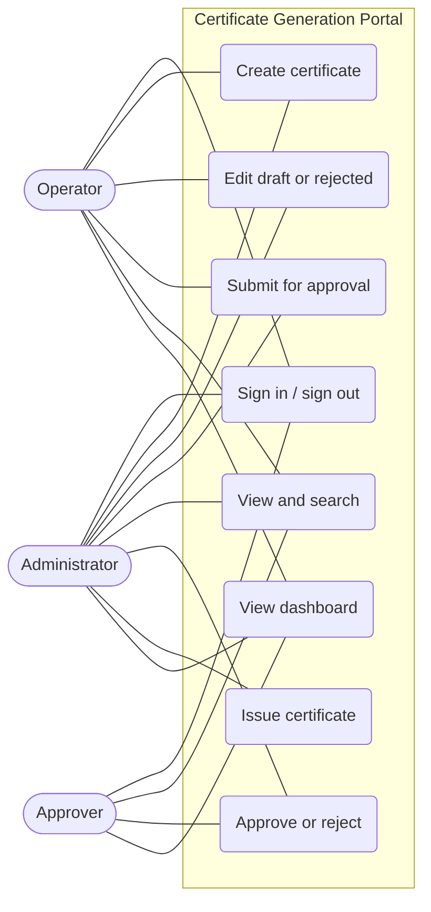
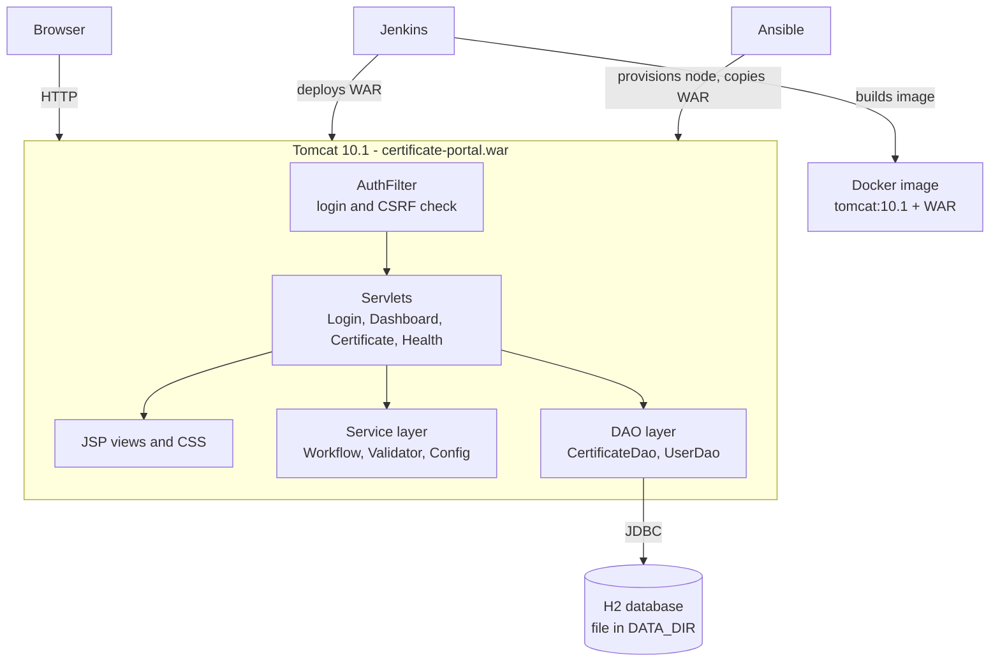
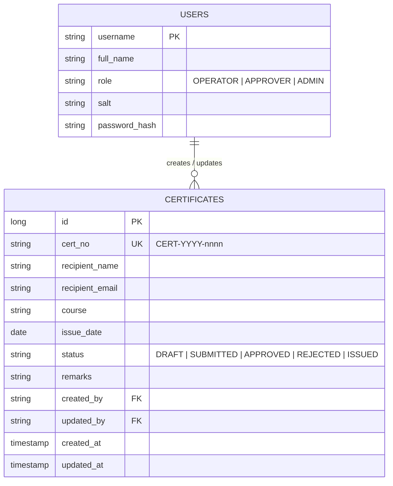

# Task 3 - Requirements, architecture and technology setup

## SRS summary
### Functional requirements
| ID | Requirement |
|----|-------------|
| FR-01 | The system shall require login; unauthenticated requests are redirected to the login page |
| FR-02 | The system shall let operators and administrators create certificate records (name, email, course, issue date, remarks) |
| FR-03 | The system shall validate all form input on the server and show field-level messages |
| FR-04 | The system shall assign a unique certificate number on creation |
| FR-05 | The system shall display a record with all details and its status |
| FR-06 | The system shall allow editing only while a record is Draft or Rejected |
| FR-07 | The system shall search by name, number or course (case-insensitive, partial) and filter by status |
| FR-08 | The system shall enforce the status workflow and the role permissions in the table below |
| FR-09 | The system shall show a dashboard with the total and a count for each status |
| FR-10 | The system shall expose `/health` returning HTTP 200 and JSON when the database is reachable |

### Workflow and permissions
| Action | From status | To status | Allowed roles |
|--------|-------------|-----------|---------------|
| Submit | Draft, Rejected | Submitted | Operator, Admin |
| Approve | Submitted | Approved | Approver, Admin |
| Reject | Submitted | Rejected | Approver, Admin |
| Issue | Approved | Issued | Admin |
| Create / Edit | - / Draft, Rejected | Draft | Operator, Admin |

### Non-functional requirements
| ID | Requirement |
|----|-------------|
| NFR-01 | Passwords are stored as salted PBKDF2 hashes; forms carry a CSRF token; session cookie is HttpOnly |
| NFR-02 | Pages respond in under 1 second for up to 1,000 records on a laptop |
| NFR-03 | The application runs on any Tomcat 10.1 with Java 17 and needs no external database |
| NFR-04 | Configuration (environment label, data folder, JDBC URL) is changeable without rebuilding |
| NFR-05 | The same WAR is used for the local, Jenkins, Docker and Ansible deployments |

## Use-case diagram

## Architecture

Pattern: servlet controllers, JSP views, plain-Java service and DAO layers (a small MVC). Business rules live in `Workflow` and `Validator`, which have no web or database code and are unit-tested directly.

## Data model

## URL / API list
| Method | Path | Purpose | Roles |
|--------|------|---------|-------|
| GET | `/login` | Login form | public |
| POST | `/login` | Sign in | public |
| POST | `/logout` | Sign out | any |
| GET | `/dashboard` | Summary dashboard | any |
| GET | `/certificates?q=&status=` | List and search | any |
| GET | `/certificates/new` | Blank form | Operator, Admin |
| POST | `/certificates` | Create | Operator, Admin |
| GET | `/certificates/{id}` | View | any |
| GET | `/certificates/{id}/edit` | Edit form | Operator, Admin (Draft/Rejected) |
| POST | `/certificates/{id}` | Update | Operator, Admin (Draft/Rejected) |
| POST | `/certificates/{id}/submit` | Submit | Operator, Admin |
| POST | `/certificates/{id}/approve` | Approve | Approver, Admin |
| POST | `/certificates/{id}/reject` | Reject | Approver, Admin |
| POST | `/certificates/{id}/issue` | Issue | Admin |
| GET | `/health` | Health check (JSON) | public |

## Technology choices
| Area | Choice | Reason |
|------|--------|--------|
| Language | Java 17 | Course tools (Maven, Tomcat, Jenkins) are Java-centric |
| Build | Maven (WAR) | Standard lifecycle, Jenkins and Selenium integrate easily |
| Web | Jakarta Servlet 6 + JSP/JSTL | Matches the "Servlet/JSP on Tomcat" target |
| Database | H2 (embedded, file) | No separate server to install; easy to reset |
| Server | Tomcat 10.1 | Jakarta EE 10 namespace, deployable by Jenkins and Ansible |
| Tests | JUnit 5, Selenium 4 (Chrome) | Unit and browser-level checks |
| CI/CD | Jenkins, Docker, Ansible | Required by the course |

## Local development setup
1. Install JDK 17, Maven 3.9+, Git (and Chrome for Selenium).
2. `git clone <repo-url> && cd certificate-portal`
3. `mvn clean package` builds `target/certificate-portal.war` and runs the unit tests.
4. Copy the WAR into a Tomcat 10.1 `webapps` folder, start Tomcat, open `http://localhost:8080/certificate-portal/`.
5. Sign in as `operator` / `operator123`.
